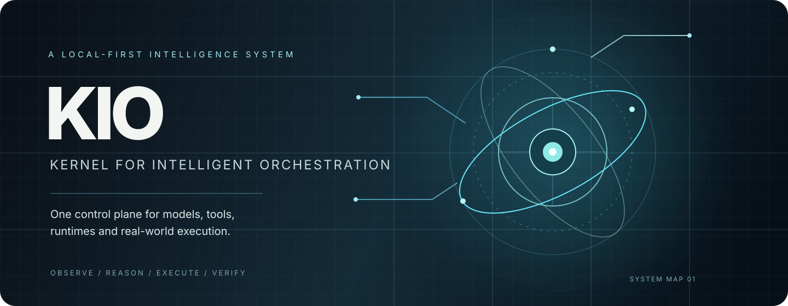
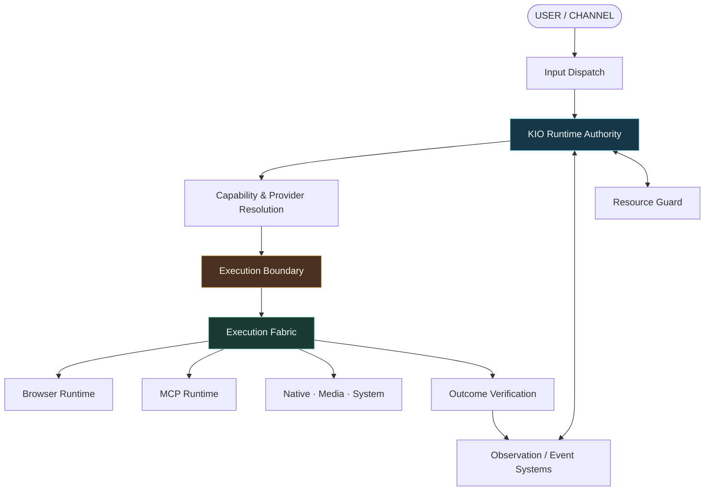

<div align="center">



<br/>

[](https://python.org)
[](./STRUCTURE_V2.md)
[](./KIO_CONSTITUTION.md)
[](#engineering-reality)

<br/>

**KIO is the control plane between intelligence and action.**

It coordinates models, tools, runtimes and interfaces through a single execution kernel — with explicit capability routing, lifecycle management, resource controls and an execution boundary.

[Explore the architecture ↓](#the-kernel)　 ·　 [Read the constitution ↗](./KIO_CONSTITUTION.md)　 ·　 [Inspect known issues ↗](./KNOWN_ISSUES.md)

</div>

---

## THE KERNEL

KIO is not another prompt wrapper. It is the system responsible for turning a request into a controlled, observable execution path.

<table>
<tr>
<td width="50%" valign="top">

### 01 — Coordinate

Route requests through runtime authority and capability providers. Keep model selection, tool discovery and execution concerns separate.

</td>
<td width="50%" valign="top">

### 02 — Control

Apply safety boundaries, resource budgets and scoped degradation before work reaches external systems.

</td>
</tr>
<tr>
<td width="50%" valign="top">

### 03 — Observe

Track runtime transitions, background tasks, provider health and execution outcomes.

</td>
<td width="50%" valign="top">

### 04 — Recover

Treat failures as first-class outcomes. Isolate unhealthy capability groups and preserve unrelated functionality.

</td>
</tr>
</table>

## INSIDE THE SYSTEM



### The boundaries matter

| System | Owns |
|---|---|
| **Runtime authority** | Bootstrap, dispatch, lifecycle, process state and background tasks |
| **Provider registry** | Mapping capability names to execution providers |
| **Execution boundary** | The safety gate between intent and side effects |
| **Browser / MCP runtimes** | Specialized external execution environments |
| **Observation bus** | Runtime signals, subscribers and telemetry |
| **Resource guard** | Memory budget enforcement and scoped degradation |

The runtime implementation is centred in `mini_kio/core/runtime.py`. See [Structure V2](./STRUCTURE_V2.md) for the current subsystem map.

## THE EXECUTION CYCLE

<div align="center">

<table>
<tr>
<td align="center" width="16%"><b>01</b><br/>OBSERVE</td>
<td align="center" width="16%"><b>02</b><br/>REASON</td>
<td align="center" width="16%"><b>03</b><br/>PLAN</td>
<td align="center" width="16%"><b>04</b><br/>EXECUTE</td>
<td align="center" width="16%"><b>05</b><br/>VERIFY</td>
<td align="center" width="16%"><b>06</b><br/>ADAPT</td>
</tr>
</table>

</div>

A request is not considered complete merely because a provider returned. KIO is designed to inspect the outcome, report partial failure truthfully and re-plan when the runtime permits it.

## CAPABILITY TERRITORY

- **Model providers** — replaceable inference backends and fallback routing.
- **Browser automation** — browser sessions and interaction capabilities.
- **MCP** — external tools over Model Context Protocol.
- **Desktop and native apps** — supported application and system operations.
- **Media** — search and playback control workflows.
- **Channels** — conversational interfaces such as Telegram.

Availability depends on configured providers, credentials and local runtime state. An adapter in the repository is not proof that a service is currently enabled.

## RUN IT LOCALLY

### Prerequisites

Python compatible with the pinned dependencies, Git, and credentials for whichever providers or channels you intend to use.

```bash
git clone https://github.com/aspire488/Kio.git
cd Kio

python -m venv .venv

# Windows
.venv\Scripts\activate

# macOS / Linux
source .venv/bin/activate

python -m pip install --upgrade pip
pip install -r requirements.txt
```

Configure integrations using the repository's configuration modules and their documentation. Do not commit API keys, bot tokens, browser profiles or local state.

### Validate

```bash
pytest
```

The suite includes network-, credential- and optional-dependency-sensitive tests. Record the exact command, environment and result when reporting validation.

## ENGINEERING REALITY

KIO is actively evolving. The repository contains a substantial runtime, provider abstractions, browser and MCP integrations, architecture doctrine, regression reports and a large test suite. It also contains known defects and unfinished convergence work.

**The README is not a release certification.** Use the current code, [known issues register](./KNOWN_ISSUES.md) and [architecture review](./ARCHITECTURE_REVIEW.md) to establish what is actually working. Architecture plans describe targets; they do not prove implementation.

## THE GOVERNING DOCUMENTS

<table>
<tr><td>🧭 <b><a href="./KIO_CONSTITUTION.md">Constitution</a></b></td><td>Identity, principles and long-term direction</td></tr>
<tr><td>⚙️ <b><a href="./KIO_ENGINEERING_OS.md">Engineering OS</a></b></td><td>Implementation and validation discipline</td></tr>
<tr><td>🗺️ <b><a href="./MASTER_CONVERGENCE_PLAN.md">Convergence Plan</a></b></td><td>Architecture roadmap and dependencies</td></tr>
<tr><td>🧩 <b><a href="./STRUCTURE_V2.md">Structure V2</a></b></td><td>Runtime and subsystem map</td></tr>
<tr><td>🧯 <b><a href="./KNOWN_ISSUES.md">Known Issues</a></b></td><td>Confirmed, deferred and resolved issues</td></tr>
<tr><td>🔍 <b><a href="./ARCHITECTURE_REVIEW.md">Architecture Review</a></b></td><td>Ground-truth reconciliation findings</td></tr>
</table>

---

<div align="center">

**A kernel should make complexity coherent — not hide it.**

<sub>Designed and engineered by <a href="https://github.com/aspire488">aspire488</a> · <a href="https://github.com/aspire488/Kio">Source code</a></sub>

</div>
