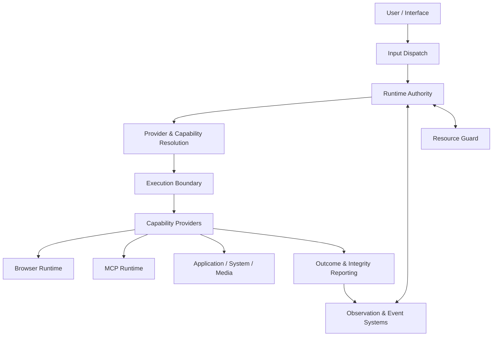

<!-- KIO / PROJECT IDENTITY -->
<div align="center">


<br/>

### Intelligence that coordinates. Infrastructure that executes.

**KIO — Kernel for Intelligent Orchestration** is a local-first cognitive kernel designed to unify models, tools, runtimes, and interfaces behind one controlled execution system.

<br/>

[](https://python.org)
[](./STRUCTURE_V2.md)
[](https://github.com/aspire488/Kio)
[](#project-status)

<br/>

[Architecture](#architecture) · [Execution model](#execution-model) · [Safety](#safety--resource-governance) · [Development](#development) · [Engineering notes](#engineering-status)

</div>

---

## 01 / The idea

Most assistants are assembled as a chain of prompts and API calls. KIO takes a systems approach.

It is the **coordination and execution kernel** between a user-facing interface and the capabilities that do the work. It routes requests, resolves providers, manages runtime state, applies execution boundaries, and coordinates browser, MCP, application, media, and system capabilities.

KIO is not intended to replace every specialized tool. It provides the control plane that makes those tools discoverable, composable, observable, and safer to operate.

> **One kernel. Multiple capabilities. Explicit control over execution.**

## 02 / System map



The runtime owns process-level state and coordinates capability execution. Providers expose concrete operations. The execution boundary is the gate between intent and real-world effects. Observation and integrity systems make runtime behaviour inspectable.

## 03 / Architecture

| Layer | Responsibility |
|---|---|
| **Runtime authority** | Bootstrap, dispatch, lifecycle, process state, background tasks |
| **Provider registry** | Resolve capability names to execution providers |
| **Execution boundary** | Enforce safety and execution constraints |
| **Browser runtime** | Browser automation and browser-facing capabilities |
| **MCP runtime** | Model Context Protocol integrations |
| **Observation bus** | Publish runtime observations to subscribers |
| **Resource guard** | Enforce resource budgets and scoped degradation |
| **Channel integrations** | Connect interfaces such as Telegram and other supported channels |

The current runtime implementation is centred in `mini_kio/core/runtime.py`. The architecture overview is documented in [STRUCTURE_V2.md](./STRUCTURE_V2.md).

## 04 / Execution model

KIO is built around a controlled lifecycle:

1. **Observe** — receive and normalize an incoming request or runtime signal.
2. **Reason** — interpret intent and identify the capability required.
3. **Plan** — select a route and determine the execution path.
4. **Execute** — invoke a registered provider through the execution boundary.
5. **Verify** — inspect the outcome rather than assuming success.
6. **Adapt** — update runtime state, report failures, or re-plan where appropriate.

Long-running work can be registered and tracked as background tasks. Capability health is scoped so a failure in one area does not automatically disable unrelated capabilities.

## 05 / Safety & resource governance

KIO treats execution control as an architectural concern, not a prompt instruction.

- **Explicit execution boundary** between routing and real-world effects.
- **Scoped degradation** so provider failures affect the capability groups that depend on them.
- **Runtime integrity tracking** with severity-weighted failure handling.
- **Resource guard** with a hard memory ceiling defined by the runtime.
- **Tracked background tasks** with status and cancellation paths.
- **Outcome verification** designed to distinguish success, partial success, and failure.

The system is designed to degrade deliberately rather than silently pretending a capability succeeded.

## 06 / Ecosystem

KIO is designed to coordinate a replaceable capability ecosystem.

| Capability family | Role |
|---|---|
| LLM providers | Reasoning and language generation through provider abstractions |
| Browser automation | Navigate and interact with browser sessions |
| MCP integrations | Connect external tools through Model Context Protocol |
| Desktop and native apps | Launch, control, and manage supported applications |
| Media | Search and control supported media workflows |
| Channels | Expose KIO through supported conversational interfaces |

Provider availability depends on local configuration and credentials. No provider should be assumed active merely because its adapter exists in the repository.

## 07 / Development

### Requirements

- Python environment compatible with the pinned dependencies
- Git
- Credentials for whichever providers or channels you intend to enable
- Optional browser/runtime dependencies for the capabilities you use

### Setup

```bash
git clone https://github.com/aspire488/Kio.git
cd Kio

python -m venv .venv

# Windows
.venv\Scripts\activate

# macOS / Linux
source .venv/bin/activate

python -m pip install --upgrade pip
pip install -r requirements.txt
```

Configure the environment using the repository's configuration modules and the relevant integration documentation before starting a channel. Do not commit API keys, bot tokens, browser profiles, or local state.

### Tests

```bash
pytest
```

The repository contains network- and provider-dependent tests. A passing or failing full-suite run depends on installed optional packages, credentials, and external service availability; report the exact test command and environment when publishing results.

## 08 / Engineering status

KIO is an actively evolving engineering project, not a declared stable release.

The repository contains a substantial runtime, provider abstractions, browser and MCP integrations, architecture documentation, regression reports, and a large test suite. It also contains documented unresolved issues and architectural convergence work. The [known issues register](./KNOWN_ISSUES.md) and [architecture review](./ARCHITECTURE_REVIEW.md) are the source of truth for those gaps.

**Current engineering posture:** preserve working systems, close verified defects, consolidate duplicated authority, and validate changes against actual runtime behaviour. Do not interpret architecture diagrams or future plans as proof that every described capability is fully integrated.

## 09 / Core documents

| Document | Purpose |
|---|---|
| [KIO Constitution](./KIO_CONSTITUTION.md) | Project identity and enduring architectural principles |
| [Engineering OS](./KIO_ENGINEERING_OS.md) | Implementation and validation discipline |
| [Master Convergence Plan](./MASTER_CONVERGENCE_PLAN.md) | Architectural convergence roadmap |
| [Structure V2](./STRUCTURE_V2.md) | Runtime and subsystem overview |
| [Known Issues](./KNOWN_ISSUES.md) | Confirmed, deferred, and resolved issues |
| [Architecture Review](./ARCHITECTURE_REVIEW.md) | Engineering review and reconciliation findings |
| [Agent Workflow](./AGENT_WORKFLOW.md) | Repository workflow guidance |

## 10 / Design principles

- **Deterministic kernel, replaceable edges.** Core orchestration should not be coupled to one model or vendor.
- **Local-first ownership.** The user retains control of runtime and data; cloud inference is an explicit provider choice.
- **Capability-based architecture.** Route by what a provider can do, not by scattered implementation-specific branches.
- **Safety before side effects.** Intent does not automatically authorize execution.
- **Evidence over claims.** Runtime behaviour, tests, and audit findings outrank aspirational documentation.
- **Convergence over accumulation.** Prefer one coherent authority over parallel registries and duplicated state.

---

<div align="center">

**KIO is the kernel. The ecosystem is what it orchestrates.**

<sub>Built in public by <a href="https://github.com/aspire488">aspire488</a> · <a href="https://github.com/aspire488/Kio">Source repository</a></sub>

</div>
